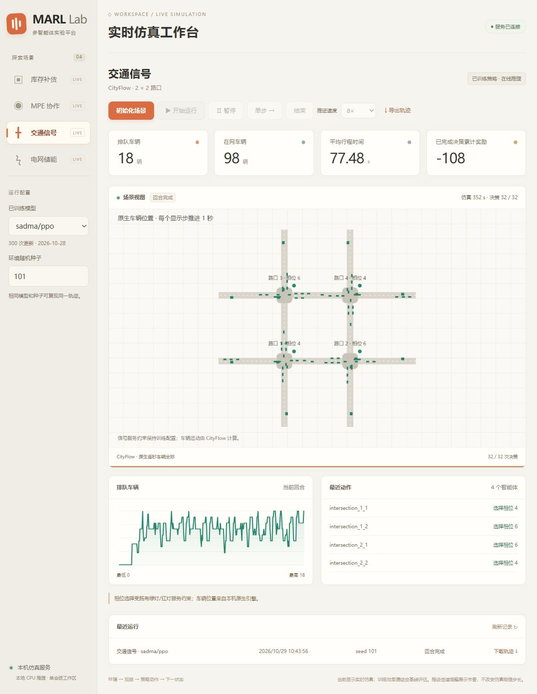

# unified-marl practical · 本地实时仿真平台

**下载 GitHub ZIP，在自己电脑启动网页。** 四个已训练模型、库存/MPE/交通/电网场景数据及 CityFlow 编译源码随仓库提供。模型推理和仿真均在本机CPU执行，不需要云服务器、SSH或显卡。

1. 安装并启动 **Docker Desktop（Linux容器模式/WSL2）**。
2. 下载本仓库 **Code → Download ZIP**，完整解压。
3. 双击根目录 **`启动本地平台.cmd`**。首次构建会联网下载环境依赖，完成后打开 `http://127.0.0.1:18765/`。
4. 选择场景，初始化，再点击开始或单步。使用完双击 **`停止本地平台.cmd`**；运行记录仍保留。

首次构建完成后，可以在没有外部网络的情况下复用本机镜像运行。源码更新后需按[本地平台说明](demos/live-platform/README.zh-CN.md)使用 `-Rebuild` 重建。核心wheel与早期安装包不包含这个完整网页平台，请下载当前源码ZIP或本地平台Release。

当前支持浅色网页、四场景实时画布、开始/暂停/单步/倍速、指标/动作/曲线和轨迹导出。平台运行已有模型，暂不提供网页训练任务和多用户管理。已有模型效果限制保留；能运行不等于策略已收敛。

[完整本地版下载](https://github.com/saimeeee/unified-marl-practical/releases/tag/v0.9.0-local.1) · [本机运行验收](docs/LOCAL_PLATFORM_REPORT.md)



## 算法与环境解耦的核心库

基于 PyMARL 风格整合多份 MARL 交付的**实用首版预发布**：算法和环境独立注册，用一份 YAML 选择算法、环境、训练参数和随机种子；新算法作为 Python 插件接入，再在兼容环境中复用。

[使用指南](docs/PRACTICAL_V1_GUIDE.zh-CN.md) · [新增算法](docs/ADDING_ALGORITHM.zh-CN.md) · [验收报告](docs/PRACTICAL_V1_REPORT.md) · [发布状态](docs/PUBLICATION_STATUS_090.md) · [本版说明](docs/releases/v0.9.0.dev1.md)

本仓库为 [`saimeeee/unified-marl-practical`](https://github.com/saimeeee/unified-marl-practical)，当前为公开仓库。[v0.9.0.dev1 核心库预发布](https://github.com/saimeeee/unified-marl-practical/releases/tag/v0.9.0.dev1)的7份附件及98 passed、1 skipped CI是历史核心库验收，见[发布回执](docs/PUBLICATION_STATUS_090.md)，不等同于本地网页平台验收。

## 安装

声明支持 **Python >= 3.10**，本轮主要验收 **Python 3.12、CPU**。其他 Python 版本和 GPU 未在本轮覆盖。建议新建独立虚拟环境。

### 从核心 wheel 安装

在新仓库的 [Releases](https://github.com/saimeeee/unified-marl-practical/releases) 中，按发布回执下载 `unified_marl-0.9.0.dev1-py3-none-any.whl` 及校验文件，然后在下载目录执行：

```powershell
python -m venv .venv
# Windows：
.\.venv\Scripts\python.exe -m pip install .\unified_marl-0.9.0.dev1-py3-none-any.whl
# Linux/macOS 使用 .venv/bin/python 执行相同的 pip install。
```

**wheel 只包含本项目核心代码和随包资源，不是离线依赖全家桶。** pip 会按包元数据获取 NumPy、PyTorch、PyYAML 等依赖；离线机器须自行准备对应平台的依赖包。Python 解释器、CityFlow、StarCraft II、外部场景数据与预训练模型不包含在核心 wheel 中。本次不要求先安装旧版平台 ZIP 或旧版补丁，也未声称已上传 PyPI。

发布使用已经验收的 wheel 原字节，其内嵌 README 是本地验收时的快照；最新使用说明以本仓库和 Release 指南为准。387 份运行源码/资源仍与当前 `src` 一致。

### 从源码安装

也可以直接克隆公开仓库：

```powershell
git clone https://github.com/saimeeee/unified-marl-practical.git
cd unified-marl-practical
python -m venv .venv
.\.venv\Scripts\python.exe -m pip install -e .
```

下文的 `python` 指向这个已安装环境；Windows 可直接替换为 `.\.venv\Scripts\python.exe`。源码仓库包含 `examples/` 与文档；核心 wheel 不包含仓库级示例目录。只安装 wheel 时，可以自行保存下面的 YAML 后运行。

## 配置驱动训练

保存为 `experiment.yaml`：

```yaml
schema_version: 1
name: qmix-mpe-first-run
algorithm: pymarl/qmix
env: mpe
seed: 11
device: cpu
env_args:
  scenario: simple_spread
  n_agents: 3
  n_landmarks: 3
  episode_limit: 25
training:
  t_max: 96
  max_updates: 2
  batch_size: 2
  buffer_size: 8
  rnn_hidden_dim: 16
evaluation:
  episodes: 3
  seed_count: 2
```

```powershell
python -m unified_marl check experiment.yaml
python -m unified_marl check experiment.yaml --instantiate
python -m unified_marl run experiment.yaml
```

默认 `check` 解析配置、导入明确指定的插件并检查能力；`--instantiate` 还会构造环境、读取 metadata 并关闭环境，均不执行训练。`run` 才采集数据、更新参数、保存模型并用独立 seeds 评估。上面的预算是端到端短跑，不能用于判断收敛或算法优劣。

数据路径相对于 YAML 所在目录解析。参数拼写错误、空矩阵、未知参数或不兼容能力会明确报错；不会换成 `toy` 来制造成功。默认输出到 YAML 父目录的 `results/` 下，自动生成新目录；显式指定 `--output-dir` 时目录必须尚不存在。

从源码根目录可直接运行更多示例：

```powershell
python -m unified_marl run examples/experiments/inventory.yaml
python -m unified_marl run examples/experiments/ppo_mpe.yaml
python -m unified_marl run examples/experiments/plugin_mpe.yaml
python -m unified_marl run-suite examples/experiments/practical_suite.yaml
```

`run-suite` 执行算法 × 环境 × 训练 seed 的独立实验。每项保留完整配置、日志、`policy.pt`、`training.pt` 和评估结果；矩阵生成 JSON/CSV。统计只在同一算法和环境条目内进行，不合并不同环境的奖励排名。独立评估 seed 不等于独立业务测试数据。

## 新算法插件

```yaml
plugins: [unified_marl.contrib.huber_iql]
algorithm: example/huber_iql
env: mpe
# 其余字段沿用单实验格式；算法特有参数放在 training 中。
```

```powershell
python -m unified_marl catalog --plugin unified_marl.contrib.huber_iql
```

插件用 `AlgorithmSpec/register_algorithm` 注册 Controller、Learner、默认参数、训练方式和能力要求；环境用 `EnvironmentSpec/register_environment` 独立注册。算法模块无需按环境名称分支。插件模块列表写入 checkpoint，评估、推理和恢复时重新导入；插件源码及其依赖仍需在目标机器安装。

`example/huber_iql` 是 IQL 的 Smooth-L1 TD 损失**教学变体**，用于演示跨环境插件接入，不计作三位作者原创，也没有性能优越性结论。完整接口和自定义 checkpoint 要求见[新增算法指南](docs/ADDING_ALGORITHM.zh-CN.md)。

Python 入口仍可使用 `train/evaluate/load_policy`：

```python
from unified_marl.experiments import run_experiment
from unified_marl import evaluate, load_policy

run = run_experiment("experiment.yaml")
score = evaluate(run["train"]["checkpoint"], episodes=20, seed=9001)
policy = load_policy(run["train"]["checkpoint"])
# 每回合 policy.reset()，再调用 policy.act(obs, avail_actions)。
```

## 已验收范围

首版通用在线协议支持 **离散动作、固定智能体数、团队标量奖励、全局状态和动作掩码**。

| 环境 | QMIX | VDN | SADMA-PPO | Huber-IQL 教学插件 | 验收后端 |
|---|---|---|---|---|---|
| `inventory` | 通过 | 通过 | 通过 | 通过 | Windows；包内库存动力学，合成仓库/SKU 需求场景 |
| `mpe` | 通过 | 通过 | 通过 | 通过 | Windows；交付 MAPT 的 NumPy `simple_spread` 粒子动力学 |
| `traffic_engine` | 通过 | 通过 | 通过 | 通过 | Linux Docker；原生 CityFlow 0.1，既有生成 2×2 路网/车流 |

上述 **12 个组合**各完成 2 次有限梯度更新、非零参数变化、保存加载一致、合法动作、独立进程评估，以及恢复后累计 3 次更新。交通需要已有 CityFlow 引擎与场景资产；核心 wheel 不负责安装引擎。

其他验收分别记录，不混加成一个“总通过数”：

- **319 passed、1 deselected**：原开发工作区的代码回归，本轮排除 ZMQ/跨机；其中历史来源对照测试依赖仓库外原始交付目录。
- **54 passed**：最后插件/实验专项复验，与上述回归重叠，不能再相加。
- **12/12 安装版矩阵成功**：QMIX/VDN/Huber-IQL × MPE/inventory × 两个训练 seeds；另有安装版 PPO 示例验证。这是独立的包安装检查，不是第三套环境覆盖。
- 安装验证从新环境的 site-packages 加载包，但依赖复用既有环境；不等同从零安装全部依赖。

具体环境、证据路径、阶段源码/版本说明见[验收报告](docs/PRACTICAL_V1_REPORT.md)。这些检查不代表长期收敛、论文结果复现、GPU 或真实业务收益。

新仓库不包含原始交付目录，因此不承诺新 clone 能复跑全部 319 项。源码安装后，可独立运行本版四个专项测试文件：

```powershell
python -m pip install -e ".[test]"
python -m pytest tests/test_mpe.py tests/test_plugins.py tests/test_experiments.py tests/test_practical_validation.py -q
```

## 保留边界

- 自带 MPE 只开放 `simple_spread`；足球、MuJoCo、机械手等尚未进入本版统一矩阵。
- SMAC/StarCraft II 与原 `ReplenishmentEnv` 需要外部依赖和资产，本轮未实跑；`inventory` 不冒充原补货后端。
- 连续动作电网保留既有应用入口，不属于当前离散算法插件矩阵，不进行隐式离散化。
- 角色/分层均场、离线/偏好、奖励模型及 SADMA 分布式等历史接口保留原命名空间和限制，本轮不宣称全部特色分支已跨环境验证。
- 恢复保存学习器、优化器、回放和全局 RNG 等；外部仿真器内部状态不在统一恢复范围。

## 历史与来源

替换前的 README 已完整保存在 [HISTORY_README_082.md](docs/HISTORY_README_082.md)，其中的旧仓库发布链接、平台 ZIP 和补丁流程仅供历史追溯，不是本版本安装入口。历史迁移范围见 [SUPPORT_MATRIX.md](docs/SUPPORT_MATRIX.md) 与 [KNOWN_ISSUES.md](docs/KNOWN_ISSUES.md)；本版本入口以本 README、首版指南和发布回执为准。

源码来源及多源许可见 [NOTICE](NOTICE)、[LICENSE](LICENSE) 和 [licenses/](licenses/)。
