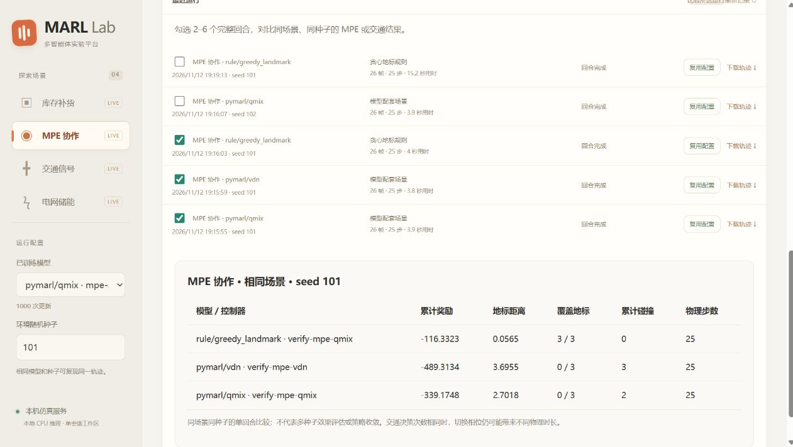

# 从自定义场景到训练、登记与对比

这一版打通本地开发流程，使用 CPU 即可做短程验证，无需租服务器。长时间多算法、多训练种子的实验，应先测量单个实验的采样速度、内存和训练耗时，再选择硬件。当前网页提供实时推理、训练包下载和结果对比；训练命令在本机环境或本地 Docker 中执行。

## 1. 导出交通训练包

网页选择“交通信号”，打开自定义场景，设置路口、计划车辆总量和信号决策次数；在“用此场景训练”选择 QMIX、VDN 或 SADMA PPO，点击“下载训练包”。包中有 `experiment.yaml`、完整 CityFlow 输入和中文说明。

训练算法与网页展示控制器独立。可以为 3×3 等新路网训练模型；原随包 2×2 PPO 的使用限制保持。默认预算为 **2 次更新**，只用于验证流程，正式实验需要调整预算及独立测试数据。

在已安装本项目及 CityFlow 的 Python 环境中，从解压目录运行：

```bash
python -m unified_marl check experiment.yaml --instantiate
python -m unified_marl run experiment.yaml --output-dir run
```

Windows 使用现有 Docker 平台时，将训练包解压到 `demos/live-platform/local-state/experiments/traffic-a/`，在 `demos/live-platform` 目录运行：

```bash
docker compose exec -T platform python -m unified_marl run /var/lib/unified-marl/experiments/traffic-a/experiment.yaml --output-dir /var/lib/unified-marl/experiments/traffic-a/run
```

命令执行期间请结束网页中的实时仿真，给训练留出 CPU 和内存。输出目录必须是新目录，重复实验请换名称。

## 2. 登记训练产物

在完整仓库目录执行：

```bash
python demos/live-platform/training_bridge.py register --run /path/to/run --state demos/live-platform/local-state --id traffic-qmix-a
```

Docker 用户在 `demos/live-platform` 目录执行：

```bash
docker compose exec -T platform python demos/live-platform/training_bridge.py register --run /var/lib/unified-marl/experiments/traffic-a/run --state /var/lib/unified-marl --id traffic-qmix-a
docker compose restart platform
```

刷新网页后，新模型出现在模型列表。登记会检查网络加载、环境维度和观测/动作协议，复制原始权重及交通场景，更新 `extra-models.json`。支持核心实验的 MPE、traffic_engine，以及 QMIX、VDN、SADMA PPO；其他插件和应用模型仍按原有方式接入。已有 ID 不会覆盖，重新训练后应使用新 ID。

登记必须在仍能访问原训练资产的环境中完成。登记完成后可以移动整个 `local-state`；登记交通模型使用独立复制的场景，不依赖检查点内旧机器的绝对路径。资产摘要保护登记后的文件完整性；它不能证明训练到登记期间输入文件没有被改动，所以请保留训练场景原件。

登记交通模型使用其配套场景，可在“已登记交通场景”选择训练模型或同场景压力规则。改变网格需要导出新的场景并训练。

## 3. 同场景比较

MPE 可选择训练模型或“贪心地标规则”；该规则读取所有位置，是集中式参考，不是学习得到的策略。交通可选择训练模型或压力规则。

保持同一场景与种子，分别运行不同模型或规则；在“最近运行”勾选 2–6 条完整回合，再点击“比较所选运行”。比较接口核对实际场景指纹、种子及指标定义；不同场景、不同种子、未完成回合及缺少指纹的旧记录会被拒绝。

表格呈现各模型实际指标，不给不同环境混算排名。交通即使决策次数相同，相位切换也可能使物理时长不同，表中另列物理步数。单回合比较用于检查行为，不代表多训练种子的算法优劣结论。



图中 QMIX/VDN 只训练两次，数值仅用于证明流程可用。

## 4. 独立测试场景

通用实验 YAML 新增 `evaluation.env_args` 和 `evaluation.path_keys`，在训练环境参数上合并评估覆盖，路径相对于 YAML。例如库存用独立需求 CSV：

```yaml
evaluation:
  episodes: 3
  seeds: [101, 102, 103]
  env_args:
    demand_file: data/test-demand.csv
```

评估种子与训练种子必须不相交。带评估覆盖时，在训练前检查两侧环境元数据；目前智能体数、观测/动作维度和回合长度须一致。实际评估配置写入 `evaluation.json`。矩阵配置中的公共评估覆盖会应用于各环境组合，不支持这些字段的组合在训练前失败并记录原因。

## 5. 验证范围

本机已通过：独立库存测试 CSV 的真实训练/评估回归；MPE QMIX 与 VDN 各两次真实 CPU 更新、模型登记、HTTP 完整回合及规则对比；浏览器训练包下载、规则选择、单步、刷新恢复、完整运行和对比表。两种 MPE 训练模型的参数均发生实际变化，登记后权重字节不变。

GitHub Actions 运行所有平台测试、核心实验回归、MPE 闭环，并在独立 Linux 任务编译随包 CityFlow。原生任务覆盖 7 种网格/车流组合，以及非 2×2 路网的导出、短训练、登记、推理和规则对比；报告作为 Actions artifacts 保存。原生验证是否通过，以对应提交的 Actions 结果为准。

2026-11-12 [CI run 43200090637](https://github.com/saimeeee/unified-marl-practical/actions/runs/43200090637) 两项任务均成功：核心回归 111 passed、1 skipped，平台 45 项通过，MPE CPU 闭环和 7 种原生交通情况通过；1×2 路网的 QMIX 两次更新、登记后摆脱原场景路径的实时推理及压力规则对比通过。[PR #1](https://github.com/saimeeee/unified-marl-practical/pull/1) 已合并，合并树与被验证源码一致。[持久验收摘要](evidence/training-workflow-ci.json)保留测试范围；完整工作进程日志在 Actions artifacts 中保留 14 天。

本轮未统一电网连续动作训练入口，也未完成长时间效果训练；四场景原有模型效果边界保持。
